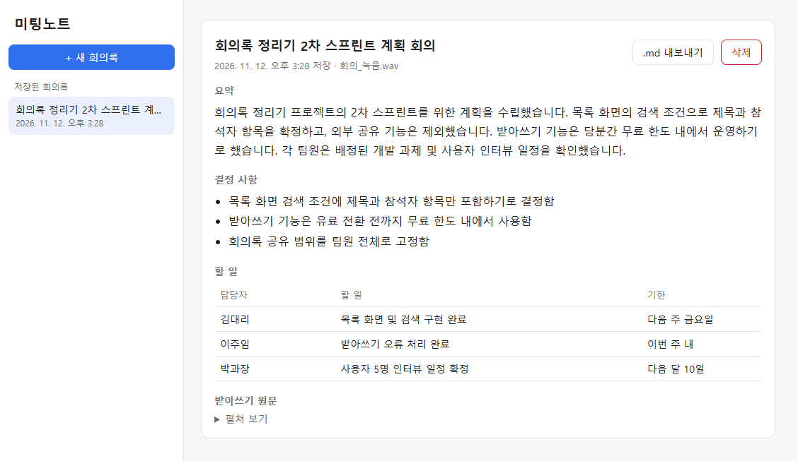
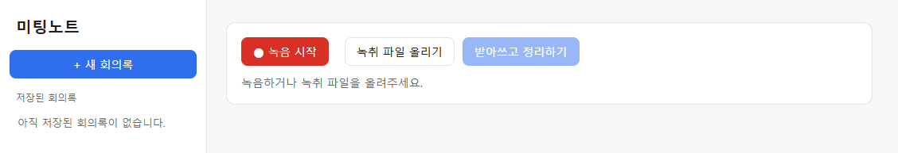
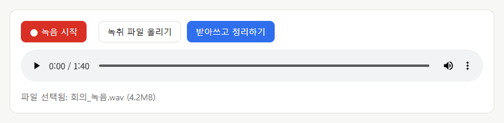
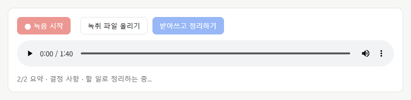
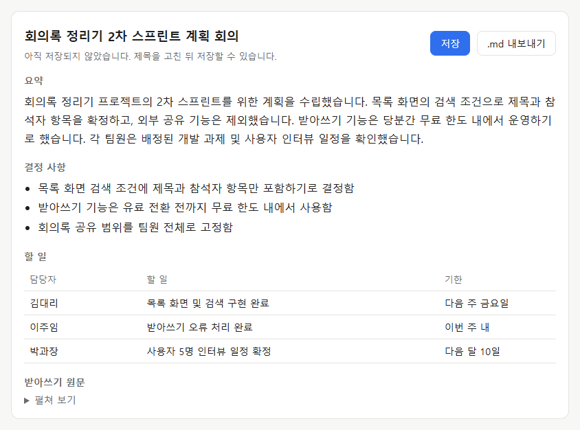
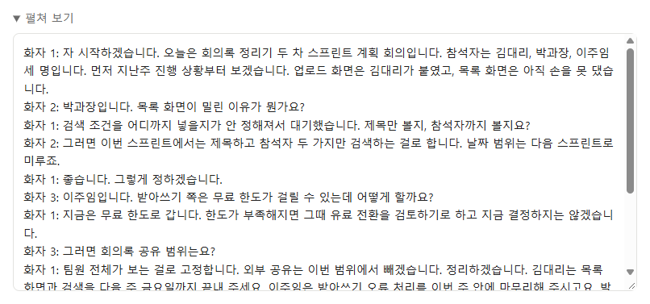
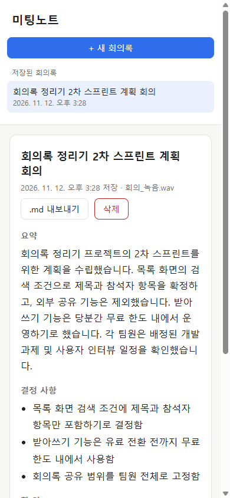
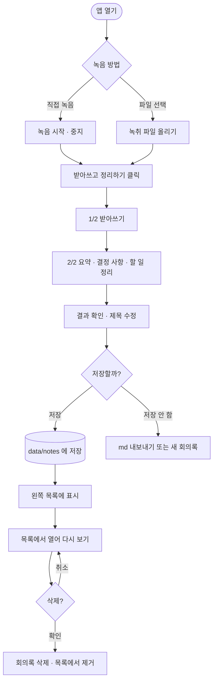
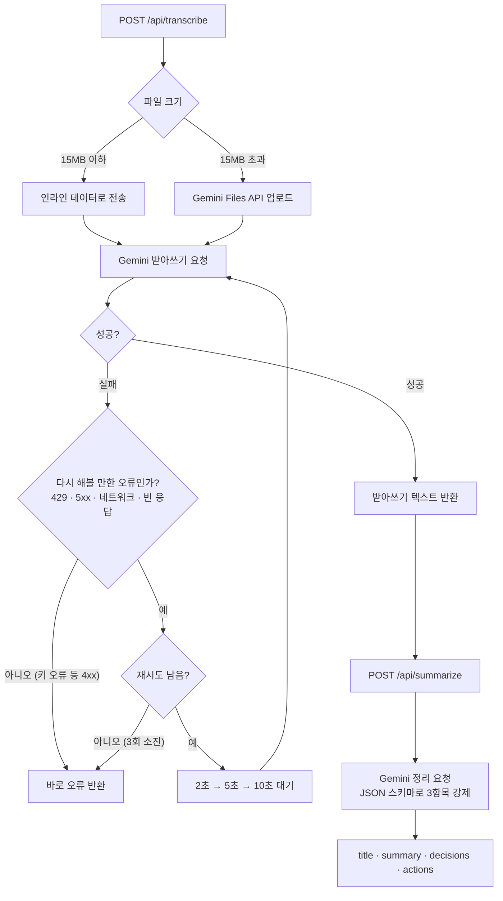
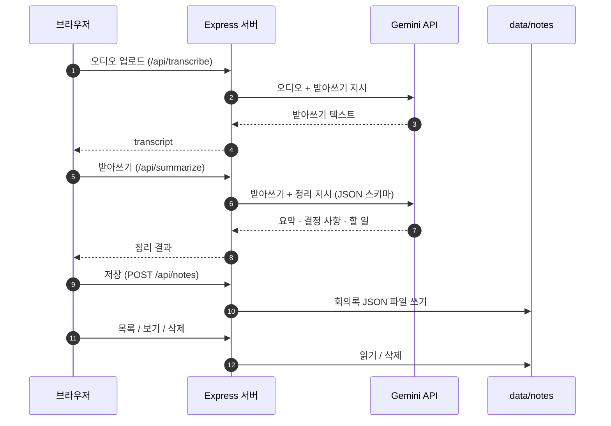

# 미팅노트 (meetingnote-simple)

> 회의 녹음을 올리면 **Gemini** 가 받아쓰고, **요약 · 결정 사항 · 할 일** 로 정리해 주는 회의록 정리기



---

## 목차

- [주요 기능](#주요-기능)
- [빠른 시작](#빠른-시작)
- [사용 방법](#사용-방법)
- [동작 흐름](#동작-흐름)
- [설정 (.env)](#설정-env)
- [API](#api)
- [프로젝트 구조](#프로젝트-구조)
- [테스트](#테스트)
- [문제 해결](#문제-해결)
- [보안 · 개인정보](#보안--개인정보)

---

## 주요 기능

| 기능 | 설명 |
|---|---|
| 🎙️ **녹음 / 파일 업로드** | 브라우저에서 바로 녹음하거나 녹취 파일(wav, mp3, m4a, webm, 영상 등)을 올립니다. |
| ✍️ **받아쓰기** | Gemini 가 한국어로 받아쓰고 `화자 1`, `화자 2` 처럼 화자를 구분합니다. |
| 🗂️ **3항목 정리** | **요약 · 결정 사항 · 할 일(담당자/할 일/기한)** 로 나눠 정리합니다. 잡담은 빼고, 보류된 내용은 결정 사항에 넣지 않습니다. |
| 💾 **저장 · 다시 보기 · 삭제** | 정리한 회의록을 저장하고, 왼쪽 목록에서 다시 열어 보거나 지울 수 있습니다. |
| 🔁 **자동 재시도** | 받아쓰기·정리가 일시적으로 실패하면 **2초 → 5초 → 10초** 기다렸다가 최대 3번 다시 시도합니다. |
| 📄 **Markdown 내보내기** | 회의록과 받아쓰기 원문을 `.md` 파일로 저장합니다. |
| 📱 **모바일 대응** | 좁은 화면에서는 목록과 본문이 위아래로 배치됩니다. |

---

## 빠른 시작

### 1. 준비물

- [Node.js](https://nodejs.org/) 20 이상
- Gemini API 키 — [Google AI Studio](https://aistudio.google.com/apikey) 에서 발급

### 2. 설치

```bash
git clone https://github.com/yjchoi3716-tech/meetingnote-simple.git
cd meetingnote-simple
npm install
```

### 3. API 키 설정

`.env.example` 을 복사해 `.env` 를 만들고 키를 입력합니다.

```bash
cp .env.example .env
```

```ini
GEMINI_API_KEY=          # ← 발급받은 키를 여기에 붙여넣기
GEMINI_MODEL=gemini-3.1-flash-lite
PORT=8100
```

> ⚠️ 키는 **`.env` 에만** 넣으세요. `.env.example` 은 GitHub 에 올라가는 빈 양식입니다.

### 4. 실행

```bash
npm start
```

브라우저에서 **http://localhost:8100** 을 엽니다.

---

## 사용 방법

### ① 녹음하거나 녹취 파일 올리기

**[● 녹음 시작]** 으로 바로 녹음하거나, **[녹취 파일 올리기]** 로 파일을 선택합니다.



파일을 고르면 미리 들어볼 수 있는 플레이어가 나타납니다.



### ② 받아쓰고 정리하기

**[받아쓰고 정리하기]** 를 누르면 `1/2 받아쓰기 → 2/2 정리` 순서로 진행 상황이 표시됩니다.



### ③ 결과 확인 후 저장

요약 · 결정 사항 · 할 일로 나뉜 결과가 나옵니다. 제목은 저장 전에 직접 고칠 수 있습니다.



**받아쓰기 원문** 은 아래쪽 `펼쳐 보기` 로 확인합니다.



### ④ 다시 보기 · 삭제

저장한 회의록은 왼쪽 목록에 최신순으로 쌓입니다. 누르면 다시 열리고, **[삭제]** 를 누르면 확인 후 지워집니다.


### 📱 모바일 화면



---

## 동작 흐름

### 사용자 흐름



### 서버 처리 흐름 (자동 재시도 포함)



### 구성도



---

## 설정 (.env)

| 변수 | 기본값 | 설명 |
|---|---|---|
| `GEMINI_API_KEY` | (필수) | Gemini API 키. 없으면 서버가 시작되지 않습니다. |
| `GEMINI_MODEL` | `gemini-3.1-flash-lite` | 받아쓰기·정리에 쓸 모델. 코드 수정 없이 여기서 바꿉니다. |
| `PORT` | `3000` | 서버 포트 (`.env.example` 기본값 `8100`) |

---

## API

| 메서드 | 경로 | 설명 | 응답 |
|---|---|---|---|
| `POST` | `/api/transcribe` | `audio` 필드로 오디오 업로드 → 받아쓰기 | `{ transcript }` |
| `POST` | `/api/summarize` | `{ transcript }` → 3항목 정리 | `{ title, summary, decisions[], actions[{owner, task, due}] }` |
| `GET` | `/api/notes` | 저장된 회의록 목록 (최신순) | `[{ id, title, createdAt }]` |
| `GET` | `/api/notes/:id` | 회의록 하나 조회 | 회의록 전체 |
| `POST` | `/api/notes` | 회의록 저장 | `201` + 저장된 회의록 |
| `DELETE` | `/api/notes/:id` | 회의록 삭제 | `204` |

**저장 형식** (`data/notes/<uuid>.json`)

```json
{
  "id": "11206ba2-a9f2-4498-8bb8-2218ddf052cf",
  "title": "회의록 정리기 2차 스프린트 계획 회의",
  "createdAt": "2026-11-12T06:28:20.000Z",
  "fileName": "회의_녹음.wav",
  "summary": "회의록 정리기 프로젝트의 2차 스프린트를 위한 계획을 수립했습니다. ...",
  "decisions": ["목록 화면 검색 조건에 제목과 참석자 항목만 포함하기로 결정함", "..."],
  "actions": [{ "owner": "김대리", "task": "목록 화면 및 검색 구현 완료", "due": "다음 주 금요일" }],
  "transcript": "화자 1: 자 시작하겠습니다. ..."
}
```

---

## 프로젝트 구조

```
meetingnote-simple/
├── server.js            # Express 서버 · Gemini 호출 · 회의록 저장 API
├── retry.js             # 일시적 오류 자동 재시도 (2s → 5s → 10s)
├── public/
│   └── index.html       # 화면 (녹음 · 업로드 · 결과 · 목록) — 빌드 없이 단일 파일
├── test/
│   └── retry.test.js    # 재시도 로직 단위 테스트
├── docs/images/         # README 스크린샷
├── data/notes/          # 저장된 회의록 (git 제외)
├── .env.example         # 환경 변수 양식
└── package.json
```

**기술 스택**: Node.js · Express 5 · Multer · [`@google/genai`](https://www.npmjs.com/package/@google/genai) · 바닐라 HTML/JS (빌드 도구 없음)

---

## 테스트

```bash
npm test
```

재시도 로직 단위 테스트 4개를 실행합니다.

| 테스트 | 확인 내용 |
|---|---|
| 일시적 오류 후 성공 | 503 이 2번 나도 3번째에 성공하면 결과 반환 |
| 429 · 네트워크 오류 | 요청 과다·네트워크 오류도 재시도 |
| 재시도 소진 | 총 4번(최초 + 3회) 시도 후 마지막 오류를 던짐 |
| 영구 오류 | 400 · 403 · 404 는 재시도하지 않고 바로 실패 |

**실제 녹음 점검 결과** (1분 40초 회의 녹음)

| 항목 | 결과 |
|---|---|
| 받아쓰기 | ✅ 732자 · 화자 3명 구분 · 약 3초 |
| 3항목 정리 | ✅ 요약 · 결정 사항 · 할 일(담당자 3명) · 약 2초 |
| 잡담 제외 | ✅ 회의 끝 점심 메뉴 대화는 회의록에서 빠짐 |
| 저장 · 목록 · 다시 보기 · 삭제 | ✅ 저장 내용과 다시 본 내용 일치, 삭제 후 404 |
| 잘못된 요청 차단 | ✅ 경로 조작·빈 파일 업로드 → 400 |

---

## 문제 해결

| 증상 | 원인 · 해결 |
|---|---|
| `GEMINI_API_KEY 를 입력하세요` 후 종료 | `.env` 에 키가 비어 있습니다. |
| `포트를 이미 다른 프로그램이 쓰고 있습니다` | 이전에 켠 서버가 남아 있습니다. 끄거나 `.env` 의 `PORT` 를 바꾸세요. |
| 모델을 찾을 수 없다는 오류 | 모델 ID 를 [AI Studio](https://aistudio.google.com/) 에서 확인하세요. 미리보기 모델은 `-preview` 가 붙을 수 있습니다. |
| 마이크를 사용할 수 없음 | 브라우저 마이크 권한을 허용하세요. `localhost` 또는 HTTPS 에서만 녹음이 됩니다. |
| 같은 녹음인데 결정 사항 개수가 달라짐 | 생성형 모델 특성상 실행마다 표현·개수가 조금씩 다를 수 있습니다. 저장 전에 확인하세요. |

---

## 보안 · 개인정보

- **API 키**: `.env` 는 `.gitignore` 로 제외됩니다. 로컬 `pre-commit` hook 이 API 키로 보이는 값의 커밋을 막습니다.
- **회의 내용**: 저장된 회의록(`data/`)과 테스트 녹음(`test-report/`)은 git 에 올라가지 않습니다.
- **외부 전송**: 녹음과 받아쓰기는 처리를 위해 Google Gemini API 로 전송됩니다. 민감한 회의는 사내 정책을 먼저 확인하세요.
- **로컬 전용**: 인증 기능이 없으므로 외부에 공개된 서버로 띄우지 마세요.
